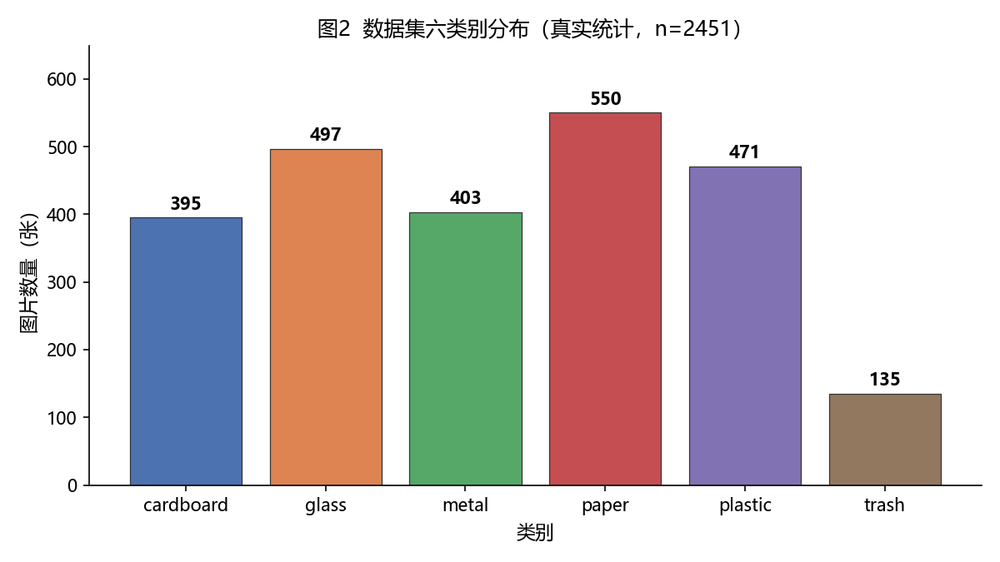
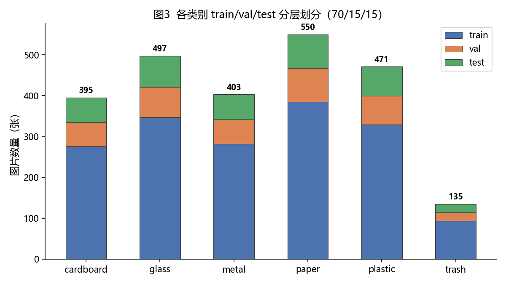
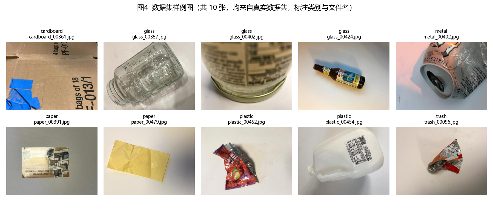

# 基于 PyTorch ResNet18 的垃圾分类六分类系统设计与实现

> 课程：深度学习案例　｜　班级：________　｜　学号：________　｜　姓名：________　｜　日期：________
>
> **写作说明**：本文件是报告正文初稿。所有标注 `【待填：…】` 处需等三组实验与评估跑完后，用本人真实运行数据/截图替换；其余内容均已按真实代码、真实数据写好，可直接粘入 Word。禁止把 Demo 范例的示例数值（3211 张、77.9%/88.6%/91.5% 等）抄入本报告。

---

## 使用声明

本报告中的数据集规模、划分数量、模型参数、实验配置、环境版本均来自本人实际运行；所有截图为本人真实运行结果。文中涉及的 AI 工具使用范围见第 14 章。本人能够解释并运行本报告所附全部代码。

---

## 必含内容索引（表 1）

| 必含内容 | 本报告位置 | 证据文件 |
|---|---|---|
| 真实数据集证明 ★ | 第 3 章 | `dataset/dataset_manifest.csv`、`dataset/samples/` |
| PyTorch 模型文件说明 ★ | 第 5 章 | `models/best_model.pth`、`models/E3_resnet18_finetune_meta.json` |
| TensorBoard 日志说明 ★ | 第 6 章 | `runs/E1_cnn/`、`E2_resnet18_frozen/`、`E3_resnet18_finetune/` |
| Loss 及其他训练曲线 ★ | 第 7 章 | `report/figures/` 下曲线截图 |
| 运行说明 ★ | 第 11 章 | `README.md`、`installed_versions.txt` |

---

## 1　项目概述

### 1.1　背景与意义
生活垃圾的分类回收是城市固废减量与资源化的第一步。传统分拣依赖人工，存在效率低、易疲劳误判、有害垃圾接触风险等问题。以卷积神经网络为代表的图像识别技术，能够对拍摄的垃圾图片给出类别判断，作为智能垃圾桶、分拣线的辅助决策手段，具有明确的落地价值。

本项目以公开的 TrashNet 数据集为基础，构建面向六类生活垃圾的整图分类系统，覆盖"真实数据整理 → PyTorch 模型训练 → TensorBoard 过程可视化 → 网页端实时推理 → 可复现交付"的完整链路。

### 1.2　项目目标与验收成果（表 2）

| 目标 | 具体实现 | 验收证据 |
|---|---|---|
| 真实数据闭环 | TrashNet 2451 张，六类，分层划分 70/15/15 | manifest、清洗日志、样例图 |
| 模型训练 | ResNet18 迁移学习 + 三组对照实验 | `train.py`、`models/*.pth` |
| 过程可视化 | TensorBoard 记录 Loss/Accuracy/LR | `runs/` 三组事件文件 |
| 网页展示 | Flask + 前端上传图片实时推理 | `app.py`、`frontend/` |
| 可复现交付 | 固定种子、固定版本、完整命令 | `README.md`、`requirements.txt` |

### 1.3　范围界定
本项目只做**六类整图分类**（cardboard 纸板、glass 玻璃、metal 金属、paper 纸张、plastic 塑料、trash 其他垃圾），不实现目标检测、多标签识别，也不替代人工复核；分类结果仅作投放建议。系统不调用任何第三方在线识别 API，推理完全由本地保存的模型完成。

---

## 2　需求分析与系统设计

### 2.1　功能需求（表 3）

| 编号 | 功能 | 说明 |
|---|---|---|
| F1 | 图片上传/摄像头 | 前端支持选择本地图片或调用摄像头 |
| F2 | 文件校验 | 类型、大小（≤10MB）、真实格式校验并预览 |
| F3 | 实时推理 | 后端加载 `best_model.pth` 对上传图实时预测 |
| F4 | 结果展示 | 显示类别（中英文）、置信度、Top-3、推理耗时 |
| F5 | 投放建议 | 根据类别给出可回收/其他垃圾的投放提示 |
| F6 | 异常处理 | 格式错误、损坏文件、推理失败给出明确提示 |
| F7 | 服务监控 | `/health` 与 `/model-info` 展示模型与设备状态 |

### 2.2　系统架构（图 1）

```
【离线训练链路】
TrashNet 原始数据
   → 清洗去重 + 分层划分（prepare_data.py）
   → dataset_manifest.csv + Dataset/DataLoader（config.get_transforms）
   → 模型构建（model.py：SimpleCNN / ResNet18 改 fc）
   → 训练循环（train.py：CrossEntropyLoss + 优化器 + 固定种子）
   → TensorBoard 记录（runs/）+ 按 val Macro-F1 保存 best_model.pth
   → 评估（evaluate.py：指标 / 混淆矩阵 / 错误案例）

                          ↓ best_model.pth + 共享预处理配置

【在线推理链路】
用户上传图片（前端 index.html）
   → 类型/大小/格式校验 + 预览（script.js）
   → POST /predict（Flask app.py）
   → 与训练同源的预处理（config.get_transforms("infer")）
   → 加载 best_model.pth 实时推理（predict.py）
   → 返回 JSON：类别 / 置信度 / Top-3 / 耗时 / 模型版本
   → 前端渲染结果与投放建议
```

两条链路通过**同一个 `best_model.pth` 和同一份 `config.py` 预处理配置**衔接，保证训练和推理在类别顺序、输入尺寸、归一化参数上完全一致。

### 2.3　非功能要求
- **可复现**：固定随机种子 42，固定依赖版本，全部命令写入 README。
- **一致性**：类别映射、预处理参数只在 `config.py` 定义一次，三处链路共同引用。
- **健壮性**：模型加载失败服务拒绝启动；上传文件做多重校验。
- **性能**：CPU 上单图推理毫秒级，满足演示需求。
- **隐私**：不记录原始文件名，不采集人脸车牌等敏感信息。

---

## 3　真实数据集证明 ★

### 3.1　来源与授权
数据集采用公开数据集 **TrashNet**（Stanford CS 231N 项目，仓库：<https://github.com/garythung/trashnet>），使用其中的 `dataset-resized.zip`（图片已统一缩放至 512×512，共 2527 张）。获取日期：【待填：实际下载日期】。授权：见原仓库许可说明，本项目仅用于课程学习与本地研究，不作为商业用途。

获取方式：由于原 `dataset.tar.gz` 链接失效，实际通过 GitHub API 原始内容端点下载 `data/dataset-resized.zip`，脚本 `src/download_data.py` 已记录该可用通道。

### 3.2　规模与划分（表 4）
数据经清洗去重后共 **2451 张**，按类别分层划分为 train/val/test = 70%/15%/15%，随机种子 42。逐类统计如下（数据来源：`dataset/dataset_manifest.csv`）：

【待填：将 `report/table3_dataset_split.md` 的表格粘贴于此】

| 类别 | 总数 | train | val | test |
|---|---:|---:|---:|---:|
| cardboard | 395 | 276 | 59 | 60 |
| glass | 497 | 347 | 74 | 76 |
| metal | 403 | 282 | 60 | 61 |
| paper | 550 | 385 | 82 | 83 |
| plastic | 471 | 329 | 70 | 72 |
| trash | 135 | 94 | 20 | 21 |
| **合计** | **2451** | **1713** | **365** | **373** |

数据集满足硬性要求：总计 2451 张（≥300）、6 个类别（≥3）、最少类 trash 也有 135 张（≥50）。

### 3.3　类别分布图（图 2）


图 2 显示六类分布存在不均衡：paper 最多（550 张），trash 最少（135 张）。这一不均衡在训练中通过类别无关的增强与 Macro-F1 指标加以关注，避免仅看总体准确率掩盖少数类表现。

### 3.4　划分堆叠图（图 3）


图 3 表明每类都按相近比例分层划分，train/val/test 三类集合互不重叠。

### 3.5　样例图（图 4）


图 4 展示从数据集中抽取的 10 张样例图，均标注类别与文件名，覆盖全部六类。

### 3.6　清洗记录与防泄漏（表 5）
清洗与划分记录见 `dataset/clean_log.txt`：

| 项目 | 结果 |
|---|---|
| 原始图片 | 2527 张 |
| 移除-损坏 | 0 |
| 移除-过小 | 0 |
| 移除-重复（感知哈希汉明距离 ≤5） | 76 张 |
| 有效图片 | 2451 张 |
| 随机种子 | 42 |
| 划分比例 | train 0.7 / val 0.15 / test 0.15 |

**防泄漏措施**：先按感知哈希去重、再分层划分，保证同一张（或近似重复）图片不会同时出现在不同集合；数据增强（随机裁剪、翻转、色彩抖动）只作用于训练集，验证/测试/推理阶段只做确定性缩放裁剪。

---

## 4　数据预处理与实验设计

### 4.1　预处理策略（表 6）
所有预处理统一定义在 `src/config.py::get_transforms(split)`，训练、评估、推理共同调用，杜绝不一致。

| 阶段 | 变换 |
|---|---|
| train | RandomResizedCrop(224, scale 0.75–1.0) → RandomHorizontalFlip(0.5) → ColorJitter(亮度/对比度 0.2、饱和度 0.15、色相 0.03) → ToTensor → Normalize(mean, std) |
| val / test / infer | Resize(256) → CenterCrop(224) → ToTensor → Normalize(mean, std) |

标准化参数采用 ImageNet 通用的 `mean=[0.485,0.456,0.406]`、`std=[0.229,0.224,0.225]`，与预训练权重一致。输入尺寸统一为 3×224×224。

### 4.2　实验矩阵（表 7）
设计三组对照实验，逐步验证迁移学习的价值：

| 实验 | 模型 | 预训练 | 冻结策略 | 优化器 / LR | Epoch | 对照目的 |
|---|---|---|---|---|---|---|
| E1_cnn | SimpleCNN（39 万参数） | 否 | 全训练 | Adam 1e-3 | 30 | 从零训练基线，衡量无预训练效果 |
| E2_resnet18_frozen | ResNet18 | 是 | 冻结卷积层，仅训 fc | Adam 1e-3 | 20 | 验证冻结特征提取 + 分类头的效果与收敛速度 |
| E3_resnet18_finetune | ResNet18 | 是 | 全量微调 | SGD 1e-4, momentum 0.9 | 30 | 产出最终部署模型 `best_model.pth` |

三组均使用 `CrossEntropyLoss(label_smoothing=0.05)`、batch size 32、固定种子 42；学习率调度 E1 用 Step、E2/E3 用 Cosine。每组按验证集 Macro-F1 选取最优 epoch 的权重保存，而非简单取最后一轮。

---

## 5　PyTorch 模型文件说明 ★

### 5.1　最终模型配置（表 8）

| 项目 | 值 |
|---|---|
| 模型名称 / 版本 | ResNet18-finetuned / v1.0 |
| 骨干网络 | torchvision ResNet18，ImageNet1K_V1 预训练权重 |
| 分类头 | Dropout(0.4) + Linear(512 → 6) |
| 输入 | 3×224×224，Normalize(ImageNet mean/std) |
| 输出 | 6 类，softmax 概率 |
| 可训练参数量 | 约 1118 万（【待填：以 E3_meta.json 为准】） |
| 损失函数 | CrossEntropyLoss(label_smoothing=0.05) |
| 优化器 | SGD, lr=1e-4, momentum=0.9, weight_decay=1e-4 |
| 最优权重选择 | 验证集 Macro-F1 最高的 epoch |

### 5.2　网络结构与关键代码
模型定义在 `src/model.py`，训练与推理共同导入，保证结构一致。核心结构：

```python
class TrashClassifierResNet(nn.Module):
    def __init__(self, num_classes=6, pretrained=True, freeze_backbone=False):
        super().__init__()
        weights = models.ResNet18_Weights.IMAGENET1K_V1 if pretrained else None
        self.backbone = models.resnet18(weights=weights)
        in_features = self.backbone.fc.in_features
        self.backbone.fc = nn.Sequential(
            nn.Dropout(0.4),
            nn.Linear(in_features, num_classes),
        )
        if freeze_backbone:
            for name, param in self.backbone.named_parameters():
                if not name.startswith("fc"):
                    param.requires_grad = False

    def forward(self, x):
        return self.backbone(x)
```

选择 ResNet18 的理由：ImageNet 预训练在数千量级的小数据集上收敛快、精度高；残差结构训练稳定；约 1100 万参数在 CPU 上可做到毫秒级推理，便于现场演示；只需替换 `fc` 层即满足"预训练模型改输出层"的要求。

### 5.3　模型文件清单（表 9）

| 文件 | 路径 | 说明 |
|---|---|---|
| best_model.pth | `models/best_model.pth` | 最终部署权重（E3 最优 epoch） |
| E3_meta.json | `models/E3_resnet18_finetune_meta.json` | 类别映射、输入尺寸、归一化参数、最优 epoch 与 F1 |
| model.py | `src/model.py` | 模型结构定义 |

### 5.4　保存与加载代码
```python
# 训练时按验证集 Macro-F1 保存最优权重
if va_f1 > best_f1:
    best_f1, best_epoch = va_f1, epoch
    torch.save(model.state_dict(), BEST_MODEL)

# 推理时加载（predict.py）
model = build_model("resnet18", pretrained=False)
model.load_state_dict(torch.load(BEST_MODEL, map_location=device))
model.eval()
```
注意：加载时 `pretrained=False`，因为权重将由 `best_model.pth` 覆盖，无需重复下载 ImageNet 权重。

### 5.5　一次真实推理结果
【待填：训练完成后运行 `python src/predict.py --image <某张未训练图片>`，粘贴真实 JSON 输出】

---

## 6　TensorBoard 日志说明 ★

【待填：训练完成后补充以下内容】
- 6.1 目录树：`runs/E1_cnn/`、`runs/E2_resnet18_frozen/`、`runs/E3_resnet18_finetune/`，每组一个事件文件。
- 6.2 实验对应表（表 10）：目录名 / 超参 / 记录内容。
- 6.3 SummaryWriter 代码：每 epoch 记录 `Loss/train`、`Loss/val`、`Accuracy/train`、`Accuracy/val`、`LearningRate`。
- 6.4 启动命令：`tensorboard --logdir runs --port 6006`。
- 6.5 每组实验目标、变量、结论，与第 7 章结果一一对应。

---

## 7　训练结果与误差分析 ★

【待填：训练完成后补充以下内容，全部用本人真实结果，禁止编造】
- 7.1 Loss 与准确率曲线截图（图 5），标注实验名、坐标轴、Epoch、关键拐点，分析收敛/波动/过拟合。
- 7.2 测试指标表（表 11）：Top-1 准确率、Macro P/R/F1、单图推理耗时。
- 7.3 混淆矩阵（图 6）与错误归因。
- 7.4 ≥5 个正确案例 + ≥2 个错误案例，结合原图、真实标签、预测、置信度、Top-3 分析原因。
- 说明：若结果不理想，保留真实数据并分析，不篡改。

---

## 8　前端页面与接口设计

### 8.1　页面区域（表 13）
前端由 `frontend/index.html`、`style.css`、`script.js` 组成，包含：顶部模型状态区（名称、版本、加载状态）、上传与预览区、结果展示区（类别、置信度、Top-3、耗时）、投放建议区、操作按钮（重新选择、再预测一次）。实现了文档要求的 10 项功能：上传/摄像头、预览、类型大小校验、发送后端、显示类别、置信度、Top-3、推理耗时、重选/再预测、加载/成功/失败三态。

### 8.2　接口设计（表 14）

| 接口 | 方法 | 说明 |
|---|---|---|
| `/` | GET | 首页 |
| `/predict` | POST | 上传图片（字段 file），返回类别/置信度/Top-3/耗时/模型版本 |
| `/health` | GET | 服务与模型加载状态、设备 |
| `/model-info` | GET | 模型名称、版本、类别列表、输入尺寸 |

`/predict` 成功返回 JSON 示例（字段结构真实，数值为示意，实际以运行为准）：

```json
{
  "status": "ok",
  "class": "plastic",
  "class_cn": "塑料",
  "confidence": 0.93,
  "top3": [{"class": "plastic", "prob": 0.93}, ...],
  "latency_ms": 45.2,
  "model_name": "ResNet18-finetuned",
  "model_version": "v1.0"
}
```

### 8.3　结果来源说明
前端所有结果均由后端加载 `best_model.pth` 实时推理得到，`script.js` 中**没有任何写死的类别或概率**。后端在 `Image.open(...).verify()` 校验图片格式后才推理，推理失败返回 500 与明确错误，不用假结果兜底。模型加载失败时服务在启动阶段即退出（见 `app.py` 的 `sys.exit(1)`），不提供带病服务。

### 8.4　前端运行截图（图 7）
【待填：上传一张图片并预测成功后，截取完整浏览器窗口截图】

---

## 9　系统测试

### 9.1　功能与异常测试（表 15）

| 编号 | 用例 | 预期 | 实测 |
|---|---|---|---|
| T01 | 上传正常 JPG 图片 | 返回类别与置信度 | 【待填】 |
| T02 | 上传 PNG 图片 | 正常推理 | 【待填】 |
| T03 | 上传 .txt 文件 | 前端/后端拒绝并提示 | 【待填】 |
| T04 | 上传超过 10MB 文件 | 返回 413 提示 | 【待填】 |
| T05 | 上传改扩展名的文本文件 | 格式校验拦截 | 【待填】 |
| T06 | 未选文件直接提交 | 提示未选择文件 | 【待填】 |
| T07 | 模型权重缺失时启动服务 | 服务拒绝启动 | 【待填】 |
| T08 | 上传未参与训练的真实图片 | 返回合理类别 | 【待填】 |

### 9.2　性能测试
【待填：同一批图片重复推理取平均耗时，记录 CPU 环境与单图耗时。】

### 9.3　兼容性
【待填：Chrome / Edge 实测结果。】

---

## 10　Docker 容器化部署（可选增强，加分项）

【可选，非验收必需】项目提供 `Dockerfile`，基于 Python 3.13 镜像安装 `requirements.txt` 依赖，运行 `python src/app.py` 暴露 5000 端口。

```bash
docker build -t trash-classifier:v1 .
docker run -p 5000:5000 trash-classifier:v1
```

---

## 11　运行说明 ★

### 11.1　环境版本（表 17）
实测环境（写入 `installed_versions.txt`，写报告时可直接引用）：

| 组件 | 版本 |
|---|---|
| Python | 3.13.x（本机实测 3.13.14） |
| PyTorch | 2.6.0+cpu |
| torchvision | 0.21.0+cpu |
| numpy | 2.2.6 |
| scikit-learn | 1.6.1 |
| matplotlib | 3.10.1 |
| Flask | 【待填：见 installed_versions.txt】 |
| CUDA | 不可用（CPU 训练） |

> 说明：原计划的 torch 2.3.1 不支持 Python 3.13，故调整为兼容的 2.6.0 + torchvision 0.21.0。课程要求的是"固定版本并如实记录"，本组合已实测通过全部训练/推理链路。

### 11.2　完整命令流（可从零复现）
```bash
cd <项目根目录>
# 1. 创建环境
python -m venv .venv
.venv\Scripts\activate          # Linux/Mac: source .venv/bin/activate
pip install -r requirements.txt

# 2. 获取数据并整理
python src/download_data.py --output dataset/raw
python src/prepare_data.py --raw dataset/raw --out dataset --seed 42

# 3. 三组训练（生成 runs/ 与各实验权重，E3 另存 best_model.pth）
python src/train.py --exp E1_cnn
python src/train.py --exp E2_resnet18_frozen
python src/train.py --exp E3_resnet18_finetune

# 4. 查看训练曲线
tensorboard --logdir runs --port 6006     # 浏览器打开 http://localhost:6006

# 5. 评估与独立推理
python src/evaluate.py --checkpoint models/best_model.pth --out report
python src/predict.py --image <一张图片路径>

# 6. 启动网页
python src/app.py                          # 浏览器打开 http://127.0.0.1:5000
```

### 11.3　权重加载路径
`best_model.pth` 位于 `models/best_model.pth`，由 `src/predict.py` 加载；`/model-info` 接口返回模型名称、版本、类别与输入尺寸。

### 11.4　常见问题（表 18）

| 问题 | 原因 / 处理 |
|---|---|
| size mismatch for fc.weight | 类别数与权重不一致；确认用 config.py 的 6 类重新训练 |
| 预测总是同一类 | 检查是否误用未训练的权重、预处理是否与训练一致 |
| TensorBoard 无曲线 | 确认 `--logdir runs` 指向正确目录并已刷新 |
| 服务启动即退出 | `best_model.pth` 缺失或损坏，按提示重新训练 |
| 准确率异常 100% | 检查数据是否泄漏（同一图片跨 train/test） |

### 11.5　复现性声明
按本节命令，使用固定种子 42 与 `requirements.txt` 固定版本，可从零复现三组训练曲线、评估指标与网页预测结果。

---

## 12　安全、伦理与局限
- **隐私**：不采集人脸、车牌等敏感信息；上传图片处理后立即删除，日志不记录原始文件名。
- **能力边界**：仅识别固定 6 类整图，不支持多目标、多标签，分类结果仅供投放参考，不替代人工复核。
- **误差来源**：透明物（玻璃/塑料）反光、目标被遮挡、低照度、类别外形相似（如纸盒与纸板）都会影响判断。
- **改进方向**：扩充数据尤其少数类（trash）、引入更细粒度类别、模型轻量化以便移动端部署。

---

## 13　结论

### 13.1　三条链路一致性
本项目通过共享配置保证"数据—训练—推理"三条链路一致：

| 环节 | 类别顺序来源 | 预处理来源 |
|---|---|---|
| 数据（manifest） | `config.py::CLASSES` | — |
| 训练（Dataset 索引） | `config.py::CLASS_TO_IDX` | `config.py::get_transforms("train"/"val")` |
| 推理（predict 映射） | `config.py::IDX_TO_CLASS` | `config.py::get_transforms("infer")` |

三者同源，避免了类别错位与预处理不一致这两类常见错误。

### 13.2　可复现性五要素
1. 固定随机种子（42）；
2. 记录并固定版本、超参、数据划分与 checkpoint；
3. 训练与推理预处理一致（共用 config）；
4. 模型加载失败时服务拒绝启动；
5. 训练、评估、推理、前端代码分离，职责清晰。

### 13.3　总结
【待填：一句话概述完成的工作与真实结果，例如"本项目完成了基于 ResNet18 迁移学习的六类垃圾分类系统，测试集 Top-1 准确率达 __%，并实现了网页端实时推理与全过程可复现。"】

---

## 14　参考资料与 AI 工具使用说明

### 14.1　参考资料（表 19）

| 资源 | 链接 |
|---|---|
| TrashNet 数据集 | <https://github.com/garythung/trashnet> |
| PyTorch | <https://pytorch.org/> |
| torchvision ResNet18 | <https://pytorch.org/vision/stable/models.html> |
| TensorBoard | <https://www.tensorflow.org/tensorboard> |
| Flask | <https://flask.palletsprojects.com/> |
| Docker | <https://www.docker.com/> |

### 14.2　AI 工具使用说明
【待填：如实说明 AI 工具在本项目中的使用范围，例如"用于代码编写辅助、错误排查与报告文字润色；核心模型结构、实验设计、数据分析与结论均由本人完成，本人能够解释并运行全部提交代码。" 请按你的真实情况填写。】

### 14.3　最终提交自查（表 20）
对照文档一要求逐项打勾，详见 `现场验收自查清单.md`：源码+链接、报告 Word、演示视频、best_model.pth、runs/ 日志、requirements.txt，以及压缩包命名与目录结构。

---

## 附：图表清单核对
- [x] 图 1 系统流程图（第 2 章，文本流程图，可转 draw.io 出图）
- [x] 图 2 数据类别分布图（第 3 章，`figures/fig2_class_distribution.png`）
- [x] 图 3 划分堆叠图（第 3 章，`figures/fig3_split_stacked.png`）
- [x] 图 4 十张样例图（第 3 章，`figures/fig4_samples_grid.png`）
- [ ] 图 5 TensorBoard Loss 与准确率曲线（第 7 章，待训练完成）
- [ ] 图 6 混淆矩阵（第 7 章，待训练完成）
- [ ] 图 7 前端运行截图（第 8 章，待前端联调）
- [ ] 表 11 测试指标表（第 7 章，待评估完成）
